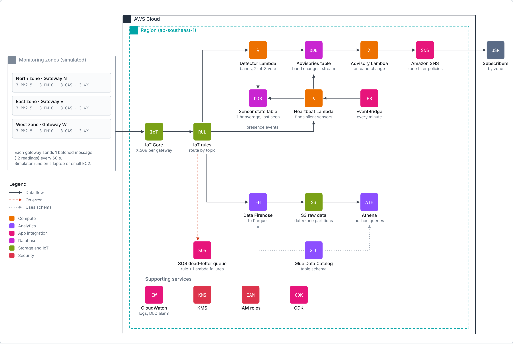

# Real-time haze monitoring on AWS

El-Nino Season is back again. 
People need to know if the air is safe to breathe
A haze monitoring system can help

> Status: phase 1 in progress. All sensor data is synthetic.



## Repository layout
```
simulator/   Haze sensor simulator (runs locally)
infra/       AWS CDK app (Python)
lambdas/     Lambda function code
tests/       Unit and end-to-end tests
docs/        Architecture diagram, design PDF, setup guide
  adr/       Decision records: why each design choice was made
```

## How it works
To measure readings from three zones (North, East and West)
Sends notifications to users when it reachers Unhealthy zone

## Requirements
- Various sensors in each zones will send particulate readings every minute.
- Track a 1-hour PM2.5 average per sensor and map it to NEA's bands (Normal 0–55, Elevated 56–150, High 151–250, Very high 251+ µg/m³).
- Notify user when the band changes tier within 2mins
- Uses an average of 12 sensors per zone for reliability
- Cost to be below $20 per month running 24/7
- Ignore a single faulty sensor; detect sensors and gateways that stop reporting.
  

## Architecture
<!-- See docs/architecture-phase1.pdf. -->

## Design decisions
| Decision | Alternative | Why |
|---|---|---|
| One batched message per zone gateway, every 60 s ([ADR 0001](docs/adr/0001-one-batched-message-per-zone-gateway.md)) | One message per sensor, every 10 s | Far fewer messages and invocations; all 3 PM2.5 votes arrive together |

## Security
<!-- IAM, encryption, certificates, least privilege. -->

## Testing and failure scenarios
<!-- One faulty sensor (no advisory), zone haze event (advisory and latency), stuck, offline, gateway disconnect. -->

## Cost
<!-- Estimate vs actual from Cost Explorer. -->

## Deploy
```bash
cd infra
source .venv/bin/activate
cdk deploy --all
```

## Teardown
```bash
cd infra && cdk destroy --all
```

## What I'd change at 10x scale
<!-- Kinesis, GSI for heartbeat, compaction, Greengrass store-and-forward, sensor calibration, multi-region. -->


